# Bob on IBM i - Premium Package for i Lab

Already comfortable with base Bob from the first lab? Good - this is the **same Bob**, now pointed at
your **IBM i**. Same modes, same approvals, you stay in control the whole time. The Premium Package
for i just adds skills and workflows built for RPG and Db2 for i.

In this lab you will use Bob on a small banking application to do four things a real IBM i developer
does every week: understand a program, document its business rules, see what a change would touch,
and build tests for it.

~60-90 minutes, on a live IBM i connection.

---

## Before you start

This lab assumes you have done the first Bob lab, so you already know **modes** (Ask, Plan, Agent),
how to **approve** changes, and how to switch things in **Settings**. We will not re-teach those here.

You also need:

- **Bob with the Premium Package for i** installed (we verify this in Setup).
- **A connection to an IBM i** - your own, or one your team provides. Connection details (host, user,
  password) come from your organization.

The sample application is **SANDBOX**, a small banking app with customer files and a credit-assessment
service program called **CREDASM**.

## The four parts (one story)

The lab tells one story end to end: **understand -> document -> impact -> test.**

| Part | What you do | The scenario |
|------|-------------|--------------|
| Setup | Connect Bob to your IBM i and install the Understand component | Get Bob onto your box |
| 1. Explain the app | Have Bob read SANDBOX and explain it | The new teammate who reads your codebase over lunch |
| 2. Business Rules | Extract CREDASM's business rules into a plain-English report | The program nobody fully remembers anymore |
| 3. Impact Analysis | Use the Understand scan for a fast blast radius | Before a risky change, what breaks? |
| 4. RPGUnit Testing | Build and run a test suite | The untested monolith, now with a safety net |

---
---

# Setup - get Bob onto your IBM i

Before the fun part, we connect Bob to your IBM i and turn on the **Understand** component, which
builds a map of your application that later parts use.

## Step 1 - Verify you have the Premium Package for i

Open **Bob Settings** (the gear icon at the top-right of the Bob panel), go to **General**, and look
under **Add-ons**. You should see **IBM Bob Premium Package for i** listed as installed.

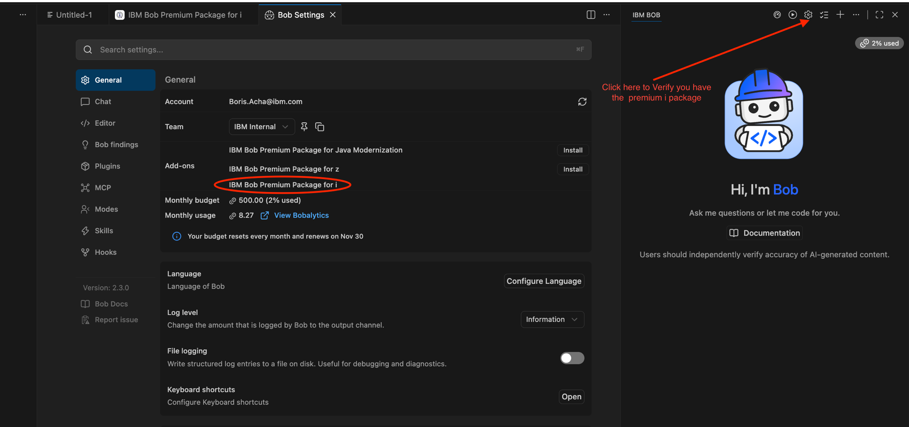

If it is not there, request access from your team before continuing.

## Step 2 - Connect to your IBM i

On the **Premium Package for i** welcome page, click **Connect to an IBM i**.

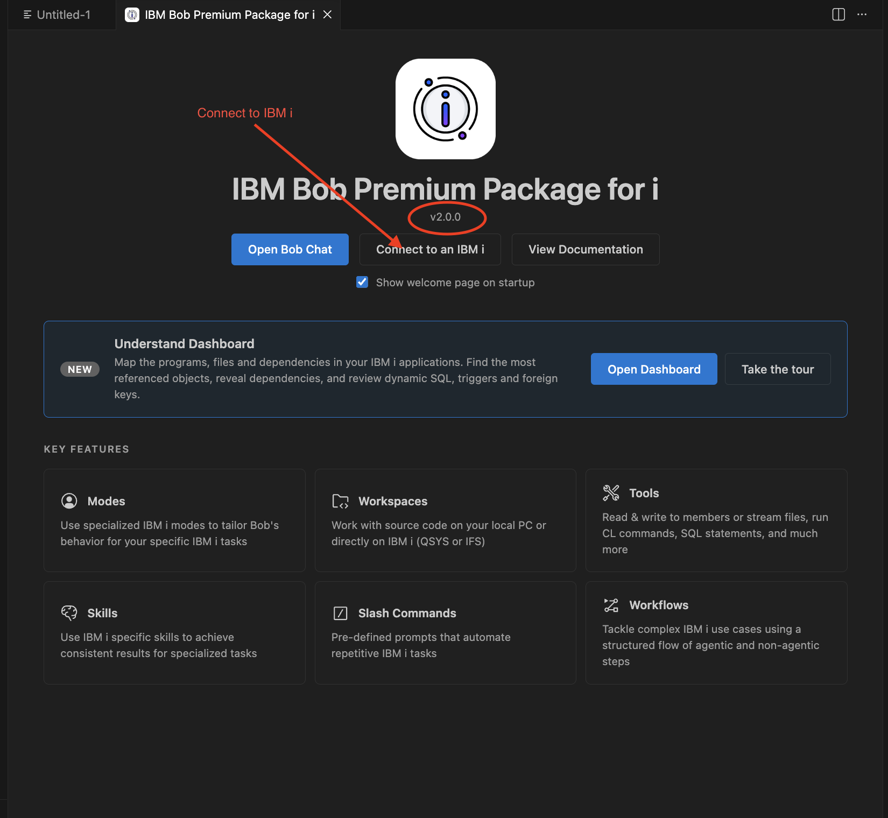

Fill in the **IBM i Login** form: a connection name, the host or IP, the port (usually 22), your
username, and one authentication method (password, private key, or SSH agent). Your organization
provides these details.

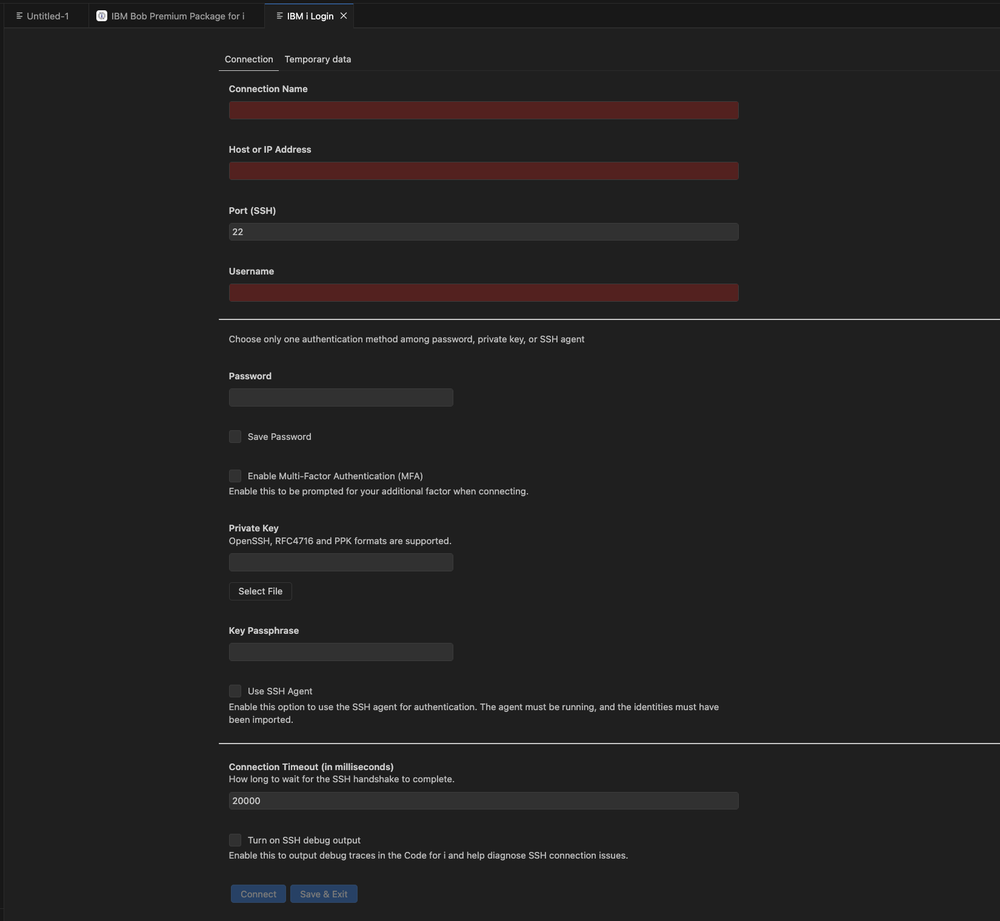

Once connected, the **IBM i panel** on the left fills in. Two parts matter: the **User Library List**
(your QSYS libraries - SANDBOX should be here) and the **IFS Browser** (folders and files on the IBM i).

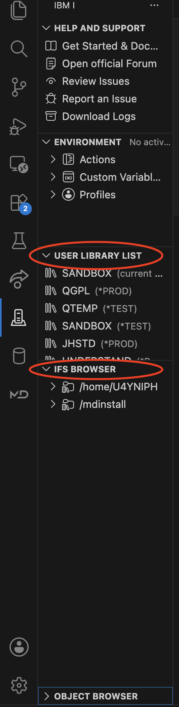

> **An IBM i has two file worlds - know both.**
> - **QSYS** is the traditional one: libraries, objects, and source members. Your RPG lives here
>   (for example `SANDBOX/QRPGLESRC/CREDASM`). Think of it as a classic filing cabinet.
> - The **IFS** (Integrated File System) is just regular folders and files, like the file explorer on
>   your laptop (for example `/home/YOURUSER/...`). The **IFS Browser** panel lets you browse it.
>
> Why this matters: later, Bob saves reports as Markdown (`.md`) files. Markdown, PDFs, and logs are
> stream files, and stream files live in the **IFS**. So you will open those reports from the IFS
> Browser, not from a QSYS library.

## Step 3 - Open the Understand Dashboard

Back on the welcome page, find the **Understand Dashboard** card and click **Open Dashboard**.

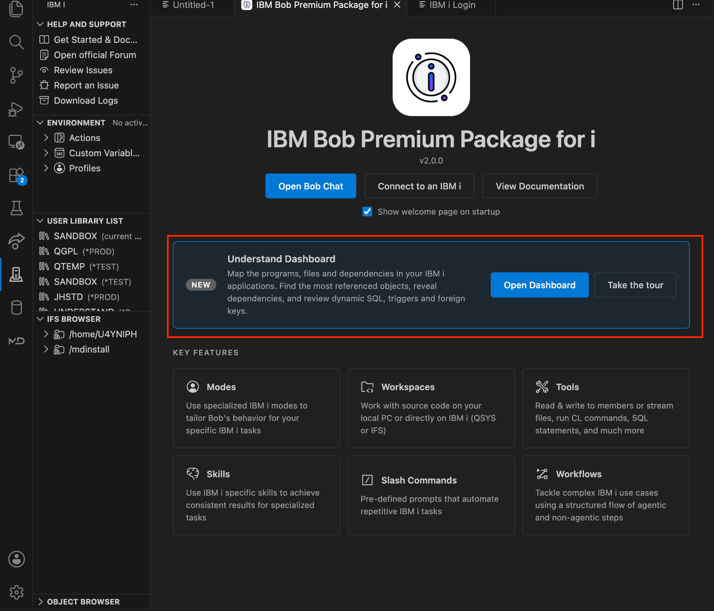

> **What is Understand? (plain English)** Understand scans your application once and builds a map of
> it - every program and file, and who references who. Think of it as an index for your codebase.
> Later, when you ask "what does changing this file touch?", Bob reads this map and answers in seconds
> instead of searching all your source.

## Step 4 - Point Understand at a library and install it

Understand stores its map in its own IBM i library. Open **Settings**, search for the
`understand.installLibrary` setting, and set the library name (we used **UNDERSTAND**) in both the
**User** and **Workspace** tabs.

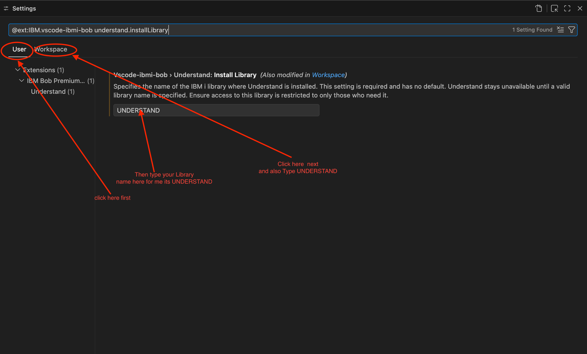

Then on the dashboard's **Getting started** list, click **Install Understand**. This creates the
Understand tables and SQL procedures in that library.

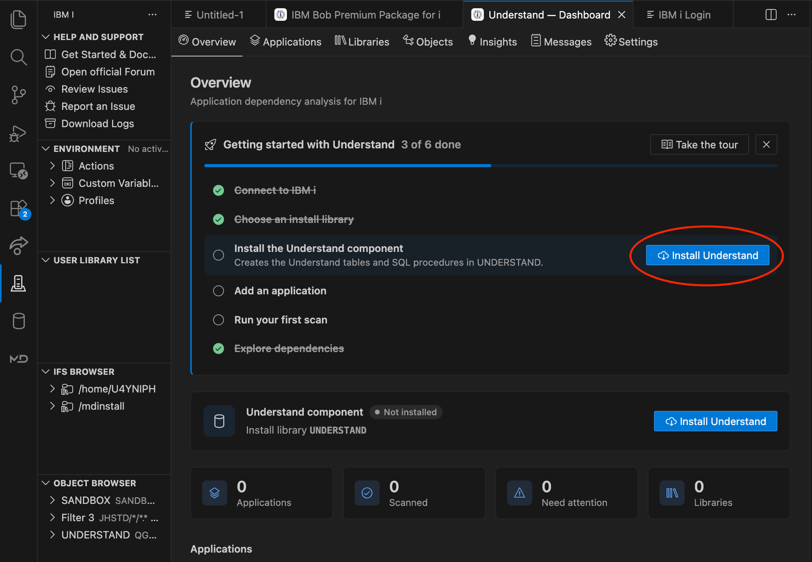

Wait for the component to show a green **Installed**.

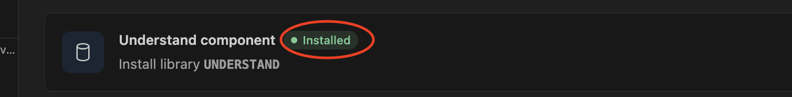

## Step 5 - Add your application and scan it

On the dashboard, click **+ Add application**.

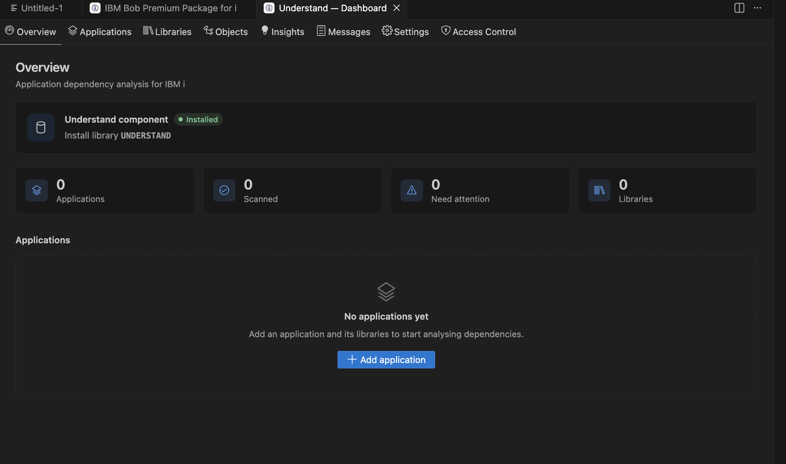

Fill in the form - **Display name:** `Sandbox App`, **Libraries:** tick **SANDBOX** - then click
**Add application**.

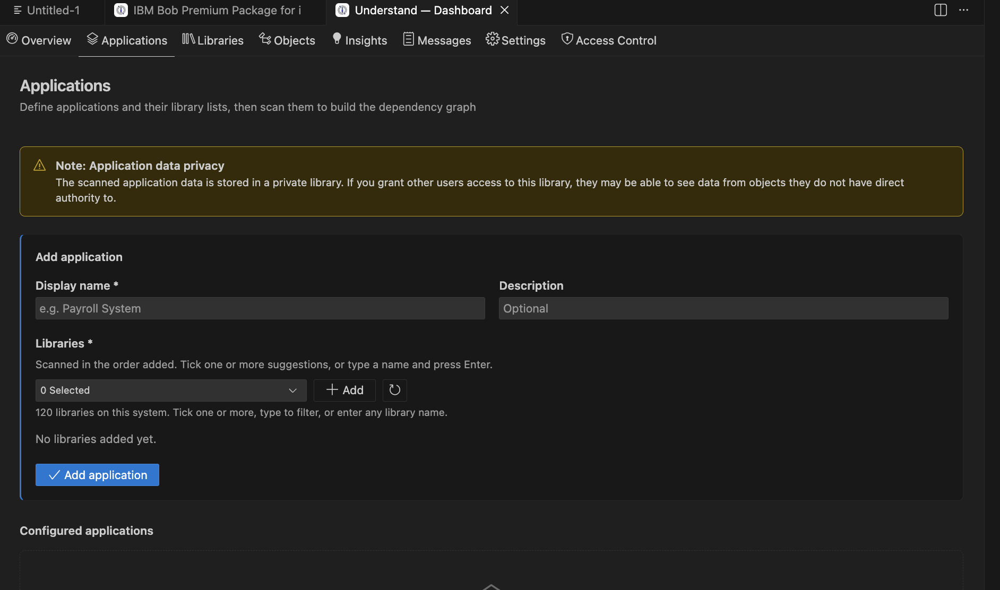

> Add the library (or libraries) your application's objects live in - this is what Understand will
> scan. For our sandbox that is just **SANDBOX**. A real app spanning several libraries would add each.

In **Configured applications**, click the **Scan** (play) button next to Sandbox App.

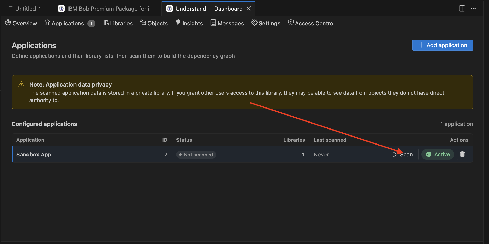

When it finishes, the status turns to **Scanned**.

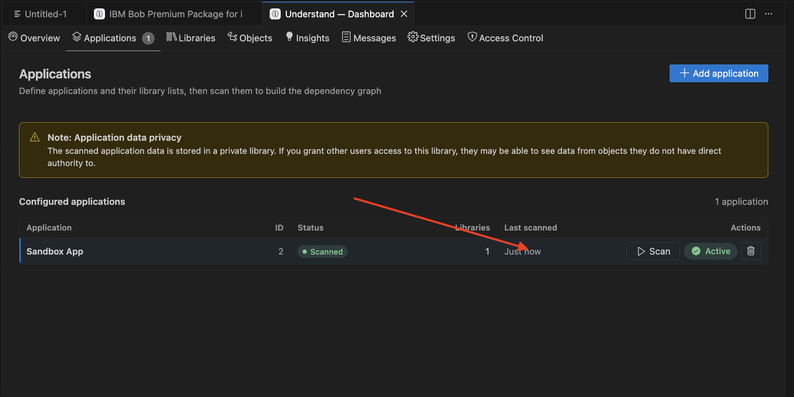

Open the **Objects** tab to see what the scan found - here, 9 objects: the customer master file
`CUSTMAST` and the customer programs. Select any object to inspect its dependencies.

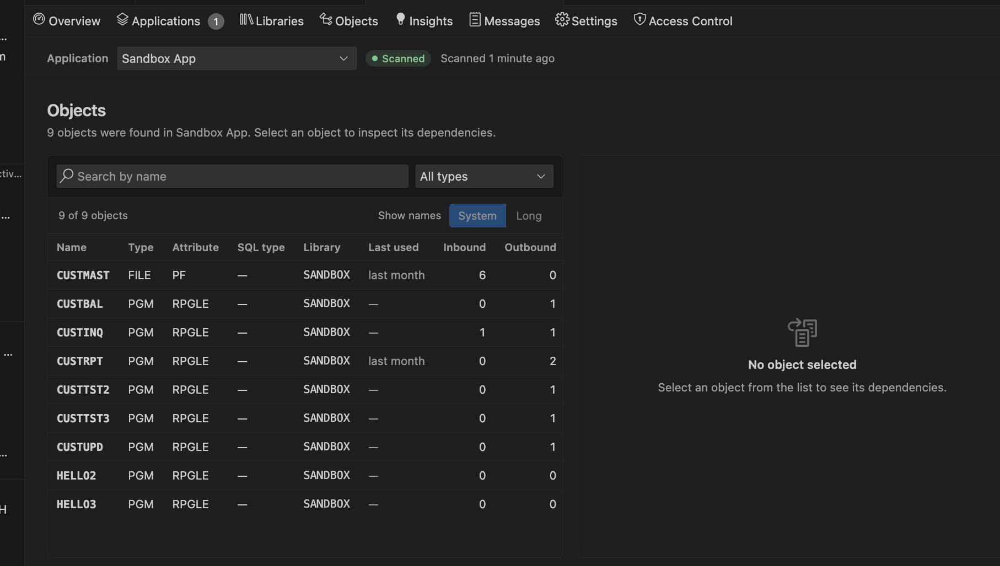

> **One honest limit:** this is an **object-level** scan (programs, files, who-calls-who). It is not
> field-level by itself. We get field-level detail in Part 3 with a quick, scoped source read.

## Step 6 - Browse the Understand library (optional, but it teaches a key idea)

The library you created (UNDERSTAND) holds the scan's data, but it will not appear in the Object
Browser until you add a **filter** for it. First, if UNDERSTAND is not in your **User Library List**,
add it: click the **+** on the User Library List and type **UNDERSTAND**.

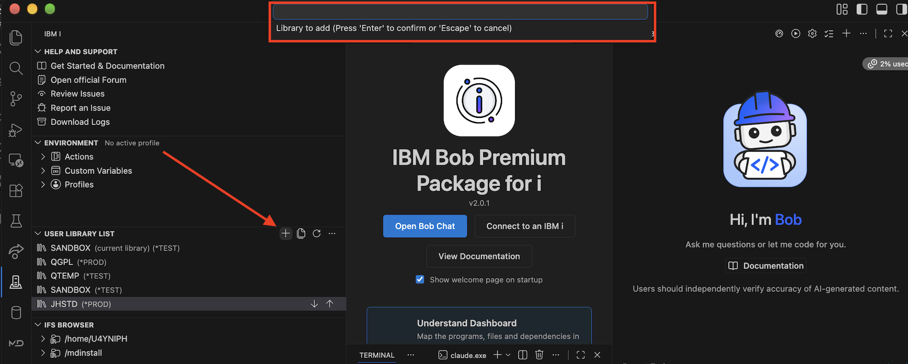

Then, in the **Object Browser**, click the **filter** (funnel) icon.

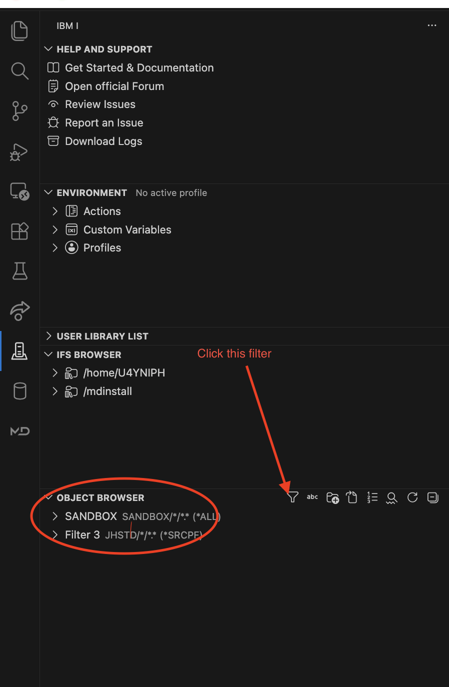

Fill in the filter and save it - **Libraries:** `UNDERSTAND`, **Objects:** `*`, **Object types:** `*ALL`.

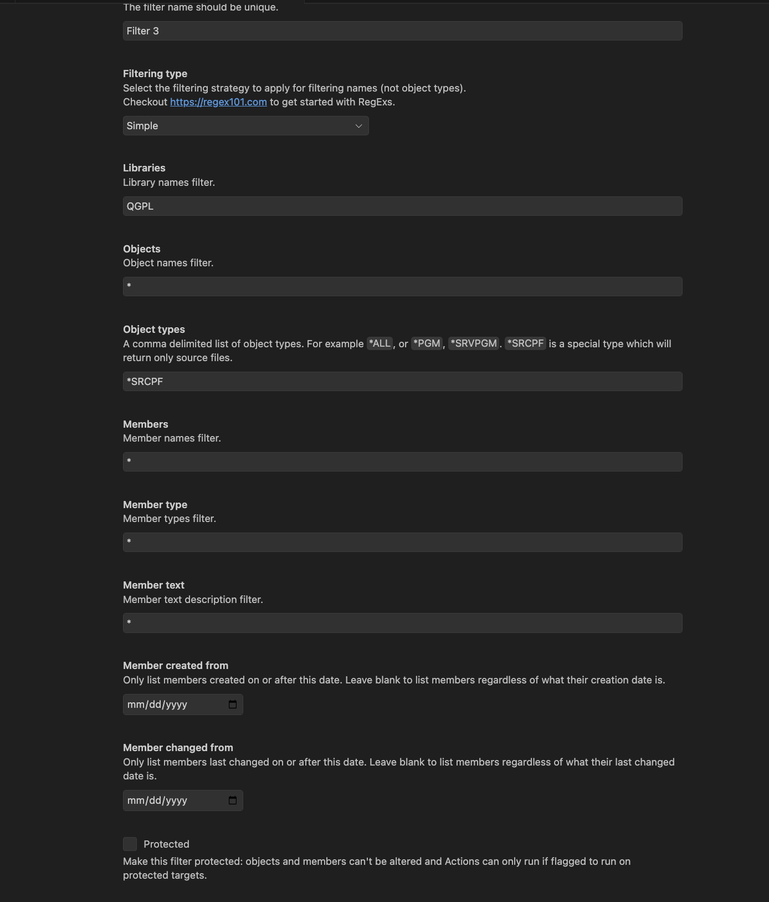

> **The filter fields (quick reference):**
> - **Libraries** - which library to browse.
> - **Objects** - object-name pattern (`*` = all).
> - **Object types** - `*ALL`, `*PGM`, `*SRVPGM`, `*FILE`... and `*SRCPF` which means **source files only**.
> - **Members / Member type / Member text** - filter source members.
>
> **Watch the Object types field.** If you leave it on `*SRCPF`, you will see nothing in UNDERSTAND,
> because that library holds **data objects, not source files**. Use `*ALL`. The lesson: a library
> will not show its contents until you add a filter, and the filter must match what is actually in there.

Now the UNDERSTAND library shows its content - the scan's metadata tables (`obj_dep` = dependency
edges, `obj_obj` = all scanned objects, `obj_expsym` = exported procedures) and SQL procedures.

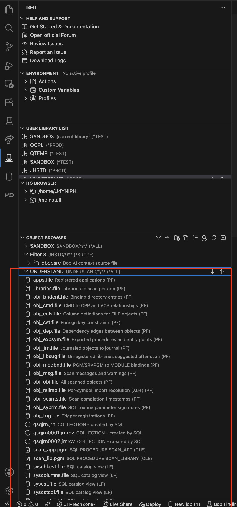

Bob is on your IBM i, the scan is done, and you know the QSYS-versus-IFS difference. Now let's put it
to work.

---
---

# Part 1 - Explain the app

> **The scenario:** you have just been handed a program nobody on your team wrote recently. Before you
> touch anything, you want the tour. This is the teammate who read your whole codebase over lunch.

## Step 1 - Start a task on the IBM i

Click the **+** (new task) in the Bob chat. Bob asks **where** you want to work.

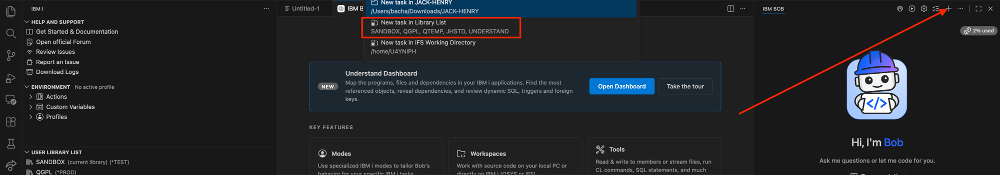

> **The three choices (plain English):**
> - **New task in a local folder** - source on your PC.
> - **New task in Library List** - the IBM i **QSYS** library list (SANDBOX, QGPL, and so on).
> - **New task in IFS Working Directory** - the IBM i IFS (regular folders).
>
> Our RPG lives in QSYS source files inside **SANDBOX**, so pick **Library List**.

Pick **New task in Library List**, and set the mode to **IBM i Developer**.

> **Why IBM i Developer mode?** It is Bob already fluent in RPG, SQLRPGLE, and IBM i - so it
> understands your code instead of guessing. For anything on the IBM i, this is the mode you want.
> (Asking it to explain is still safe - it only reads.)

## Step 2 - Ask it to explain, using the scan

Paste this prompt. Notice it tells Bob to use the **Understand scan** for the structure first, then
read source for the detail:

```
Explain the SANDBOX banking application. First use the Understand scan for the Sandbox App to map out
the structure - the programs and files it contains and how they reference each other (which objects
are most-referenced, who calls what). Then read the relevant source to walk me through exactly what
happens when a customer's balance is updated.
```

> **Why point it at the scan?** You already ran the Understand scan in Setup - it figured out the
> app's structure. Instead of making Bob rediscover everything, you tell it to use the scan for the
> big-picture map and only read source for the detail you care about. Faster, and the scan pulls its
> weight right away.

## Step 3 - Read what it gives you

Bob returns a structured explanation. Section 1 comes **from the Understand scan** - the object map,
the most-referenced object (`CUSTMAST`, with 6 inbound references), a dependency diagram, and the
data model (`CUSTREC` keyed on `CUSTID`; fields `CUSTID`, `CUSTNAME`, `BALANCE`).

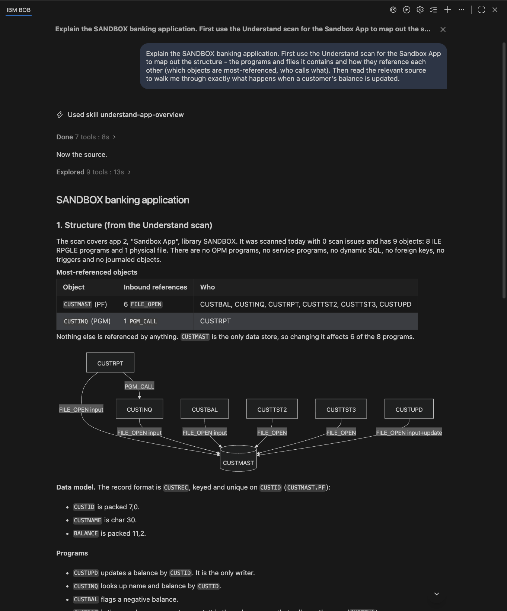

Then it reads source for the balance-update flow and - this is the good part - flags the **risks** it
found: no audit trail, silent failure on a missing customer, no I/O error handling, and places the
code does not match the project's standards.

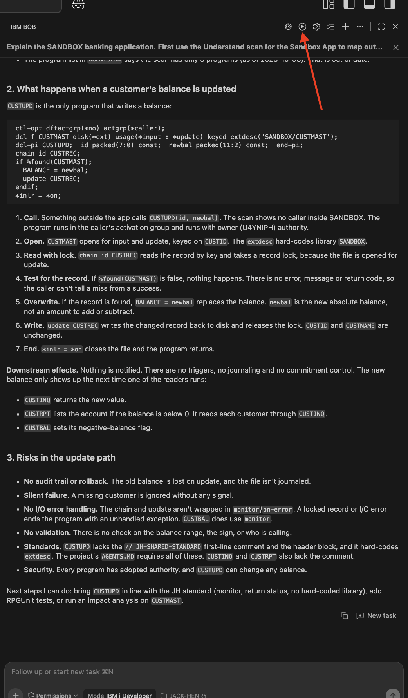

**You just learned:** Bob can read an IBM i application it has never seen, use the scan for structure,
read source for detail, and give you an honest tour - risks included.

---
---

# Part 2 - Business Rules Extraction

> **The scenario:** every shop has that one program that encodes years of business decisions, and the
> people who wrote it have moved on. You point Bob at it and get those rules back in plain English -
> straight from the code - so an analyst can read them, not just a developer.

We run this on **CREDASM**, the credit-assessment service program (it decides whether a customer
qualifies for a loan, sets the interest rate, and calculates the monthly payment).

## Step 1 - Start the Business Rules Extraction workflow

In the Bob chat, click the **Start Workflow** (play) icon at the top.

> **What is a workflow? (plain English)** In base Bob you drove step by step. A workflow is a guided,
> multi-step process for a common IBM i job - it walks you through it and does the heavy lifting.

The **Bob workflows** panel lists five. Click **Start** on **Business Rules Extraction**.

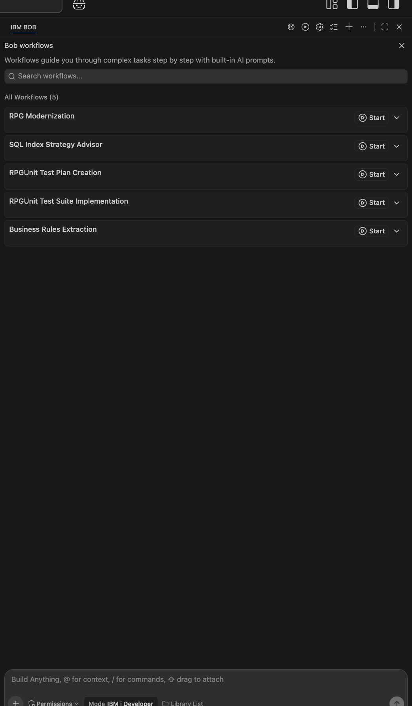

Read the **Welcome** screen, then click **Get Started**.

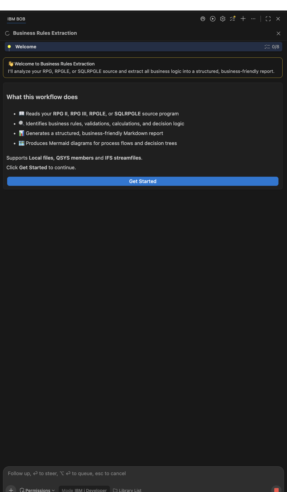

## Step 2 - Point it at CREDASM

The workflow detects your QSYS workspace and walks you through three picks:

**Library** - choose **SANDBOX**.

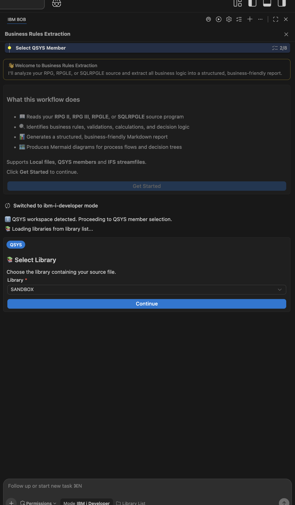

**Source file** - choose **QRPGLESRC**.

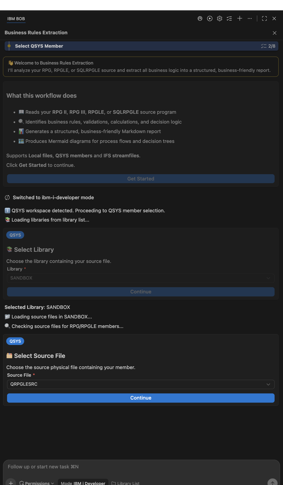

**Member** - choose **CREDASM.SQLRPGLE**, then click **Analyze Member**.

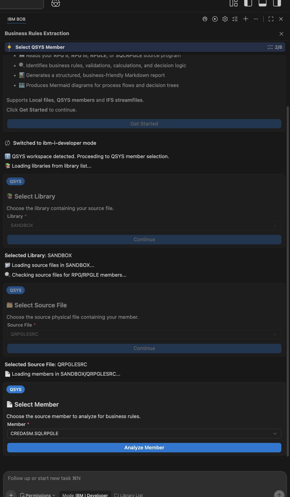

## Step 3 - Watch it work

Bob parses the program, checks for external dependencies, extracts the rules, and generates the report.

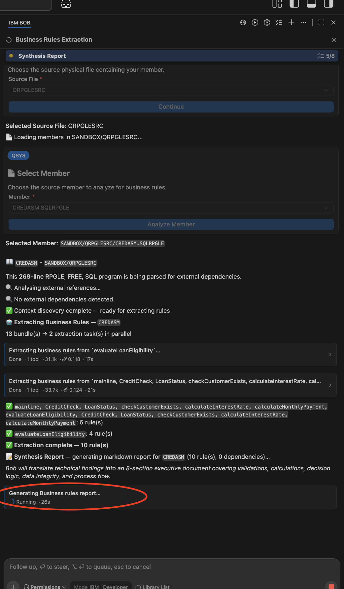

A few things to notice:

- **"No external dependencies detected."** CREDASM is self-contained, so the workflow runs clean. (If
  a program *does* reference other files Bob cannot find, it will ask you for the path - just provide
  it. That is normal, not an error.)
- It found **10 business rules** across the program's procedures (credit check, loan status, interest
  rate, monthly payment, loan eligibility).
- The whole thing cost well under a coin.

When it is done, it offers a **save location** - an IFS path for the Markdown report. Accept it and
click **Continue**.

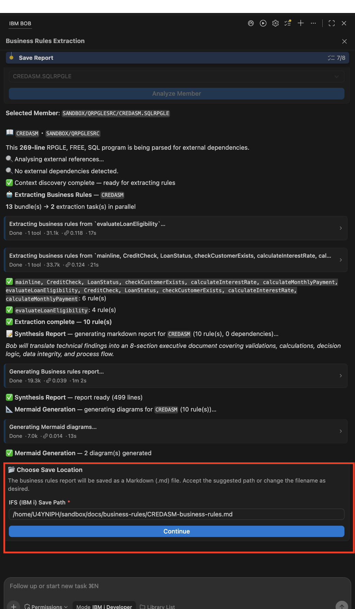

## Step 4 - Read the report

Open the saved file from the **IFS Browser** (Markdown reports live in the IFS). Turn on **Preview** to
read it nicely.

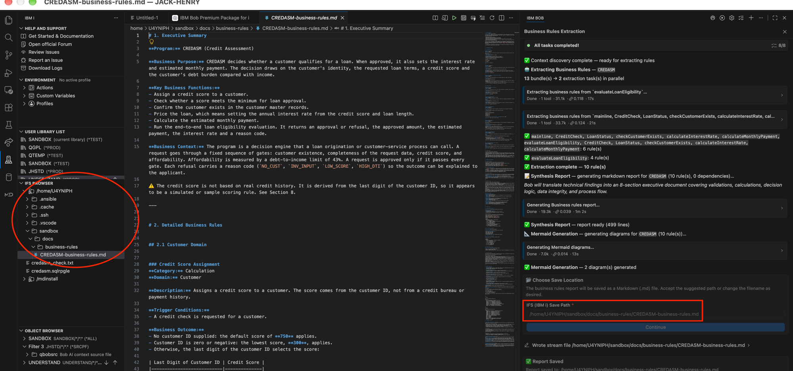

This is a real, business-friendly document: an **Executive Summary** (the program's purpose, its
decision gates - customer exists, data complete, credit score, affordability at a 43% debt-to-income
limit - and the refusal reason codes `NO_CUST`, `INV_INPUT`, `LOW_SCORE`, `HIGH_DTI`), an **honest
note** that the credit score here is simulated, and **detailed business rules** across eight sections.

It also generated **Mermaid diagrams**. Open one to see the whole decision tree drawn out.

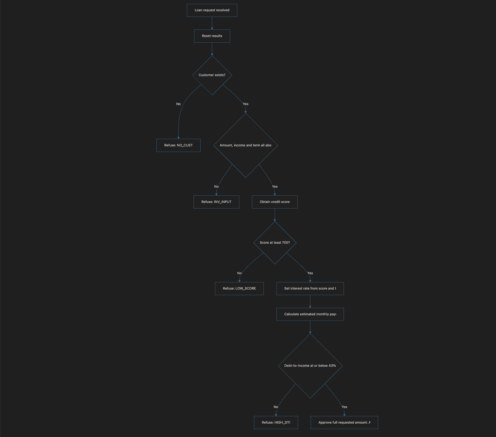

**You just learned:** Bob read a 269-line RPG program and turned it into a readable rules document
plus a decision diagram - plain English, the reason codes, even an honest note that the score is
simulated - for pennies.

---
---

# Part 3 - Impact Analysis

> **The scenario:** you are about to change a field on a heavily-used file. Before you do, you need the
> blast radius - every program and object that would be affected. On IBM i these dependencies are easy
> to miss with a manual search. The Understand scan already mapped them, so this comes back fast.

## Step 1 - Ask for the blast radius, from the scan

New task, **Library List** workspace, **IBM i Developer** mode. Paste:

```
Using the Sandbox App Understand scan metadata only - don't read the source. What is the full blast
radius if I change CUSTMAST? List every program that reads or writes it, rank them by impact, and show
the dependency as a diagram.
```

> **This is the whole point of this part.** The key phrase is "scan metadata only - don't read the
> source". Because the scan already mapped everything, Bob answers in **seconds** instead of grepping
> your whole library (which is slow and easy to get stuck in).

## Step 2 - Read the blast radius

Right at the top, Bob says **"I used scan metadata only and read no source."** It returns a ranked
list of the programs that touch CUSTMAST (CUSTUPD is the only writer - the risky one), a risk rating
(Medium to High for a record-format change), and a colour-coded dependency diagram.

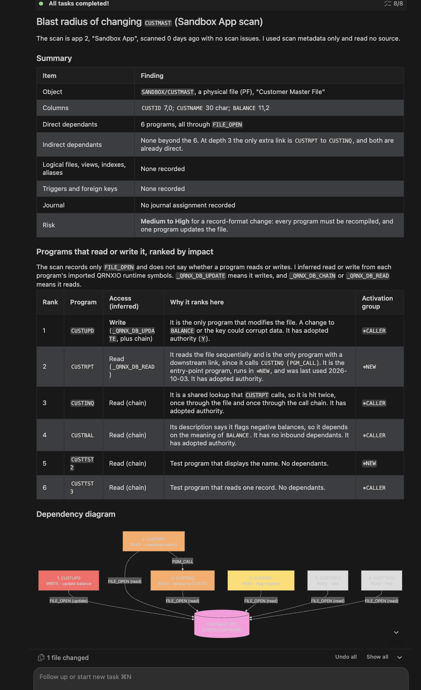

## Step 3 (optional) - Go to field level

The blast radius above is **object-level** and instant. For field-level detail, follow up - this one
reads source, but only the few programs involved, so it is still fast:

```
Now read only those programs' source and tell me which ones specifically use the BALANCE field, with
member:line citations.
```

Bob reads just those programs (here, 6 files in about 7 seconds) and gives exact `member:line`
citations - CUSTUPD writes BALANCE at line 15, CUSTINQ returns it at 39, CUSTBAL flags it negative at
31 - plus which change types force a recompile, and a sharp hazard (resizing BALANCE means changing
three hard-coded `packed(11:2)` declarations together, or you get wrong data at runtime).

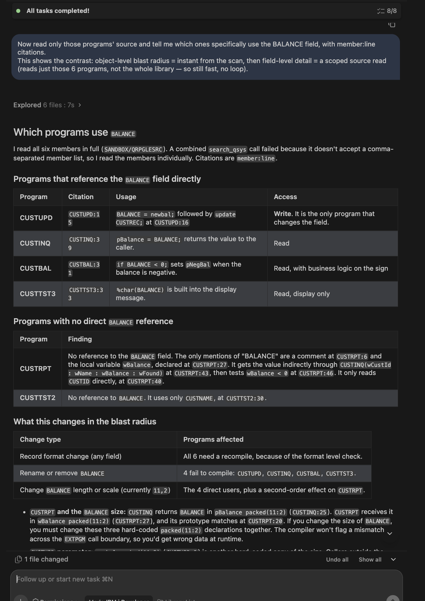

**You just learned:** two levels of impact - an **object-level blast radius that is instant from the
scan**, and **field-level detail from a quick, scoped source read**. No slow grep of the whole library.

---
---

# Part 4 - RPGUnit Testing

> **The scenario:** the program you are afraid to change. Tests are the safety net that lets you change
> it with confidence. Bob reads the code, plans the tests, writes them, and runs them.

> **Why CREDASM?** RPGUnit tests **exported procedures**. CREDASM is a service program built from
> procedures (checkCustomerExists, calculateInterestRate, evaluateLoanEligibility, and so on), so each
> one is directly testable. Programs that keep their logic in the mainline (like CUSTUPD) are not
> directly unit-testable - that is the "monolith" problem, and the first step for those is to extract
> their logic into procedures. CREDASM already is, which is why it is the one we test.

## Part 4a - Create the test plan

Click **Start Workflow** and choose **RPGUnit Test Plan Creation**. The Overview explains it produces
four kinds of Markdown docs (templates, module docs, test suite docs, and a utilities doc). Click
**Get Started**.

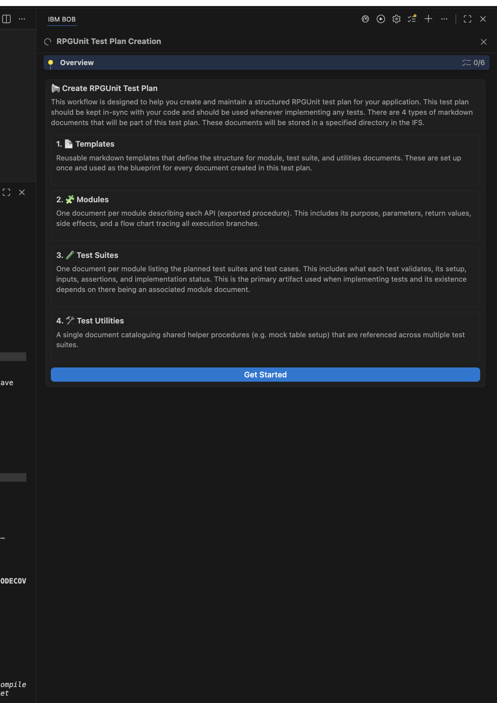

Pick your **Working Library** (**SANDBOX**) and accept the **IFS Project Directory**, then **Proceed**.

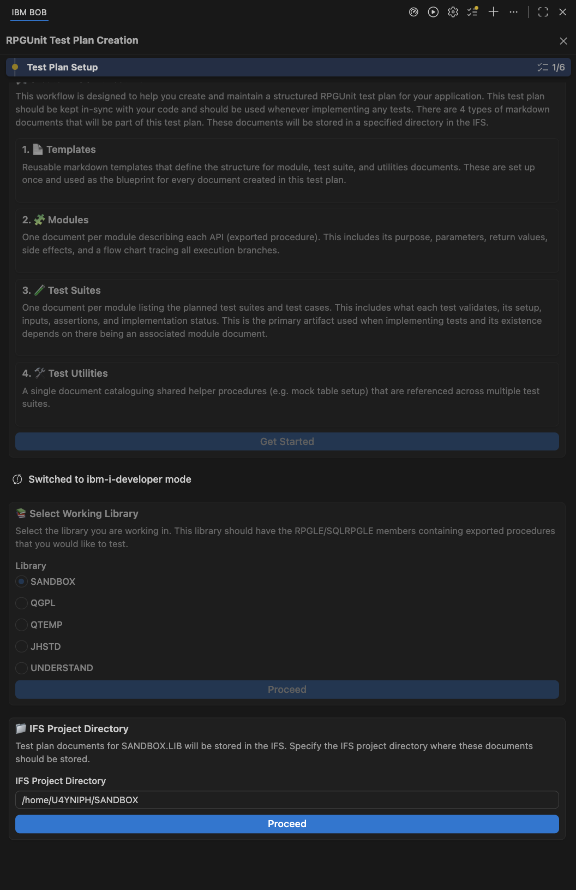

When asked, choose **"No - Create one for me"** (we are starting fresh).

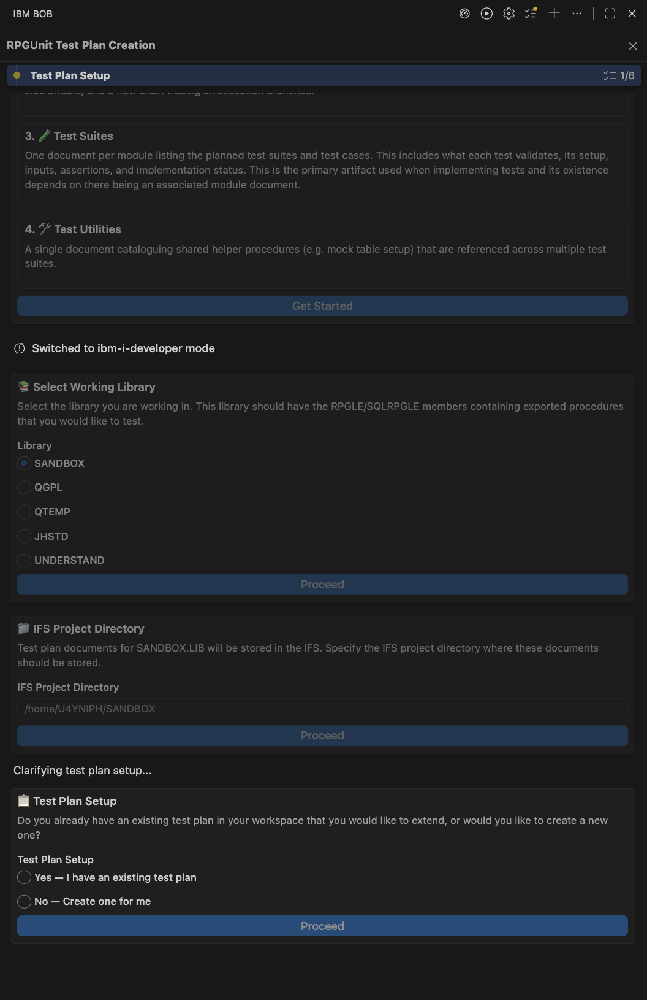

Accept the default **directory structure** - these are just folder names for organizing the test-plan
docs in the IFS (editable to match your team's layout).

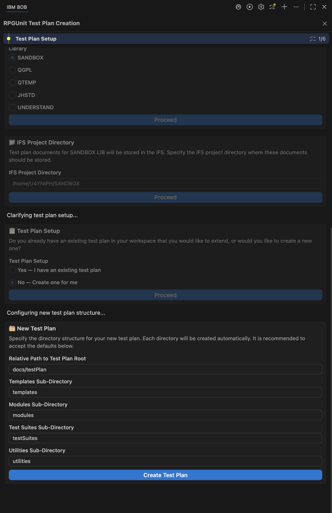

For the **goal**, pick **"Document New Module and Test Suite (Recommended)"** - it does both at once,
best for a fresh start.

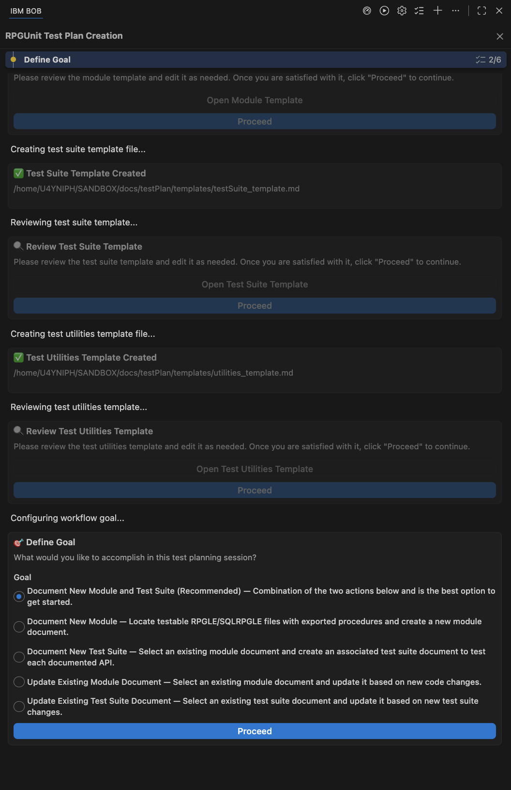

For **Location Strategy**, keep **Locate (Recommended)** so Bob finds the testable files for you. It
searches 9 members and finds **one testable file - CREDASM, with 6 procedures.** Keep it checked and
**Proceed.**

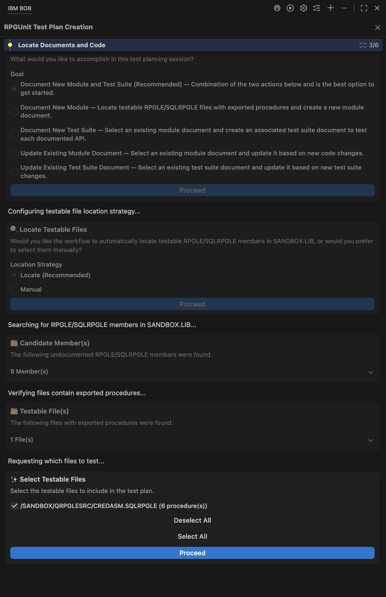

> **This is the monolith lesson, live.** Bob checked all 9 members and only CREDASM came back as
> testable - because it is the only one whose logic lives in exported procedures. The others keep their
> logic in the mainline, so RPGUnit cannot test them directly.

Keep all 6 procedures checked. The workflow then **validates the environment** - it needs **RPGUNIT**
(to compile and run tests) and **QDEVTOOLS** (for coverage). If RPGUnit is not installed, it offers to
install it for you - click **Install**.

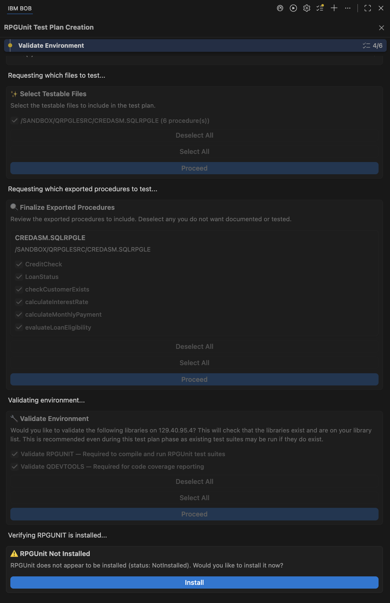

> **Good news for setup:** the workflow installs RPGUnit itself and adds it to your library list - so
> there is no separate extension setup to do by hand.

Pick the **version** (v6.0.0 Recommended) and let it install.

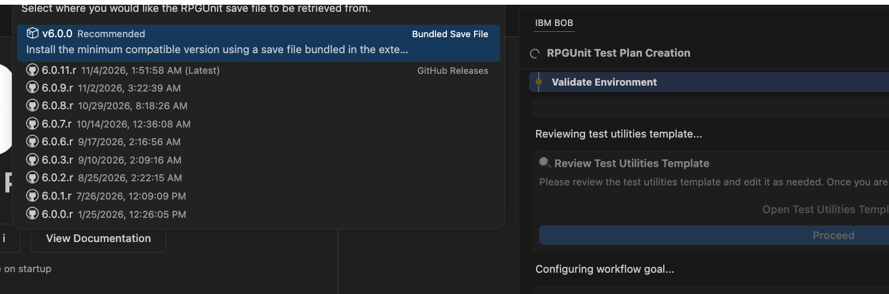

RPGUnit installs successfully. Choose **"Yes - Update my library list for me"** so RPGUNIT (and
QDEVTOOLS) are on the list.

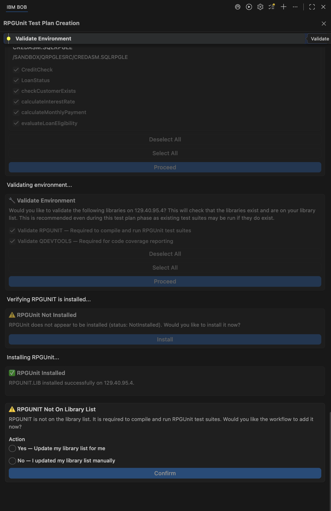

With the environment ready, the workflow launches a subtask to generate the docs. **Approve** the
subtask, and **approve** its todo list (load the rpgunit-testing skill, inspect templates, inspect
source, create the module/test-suite/utilities docs).

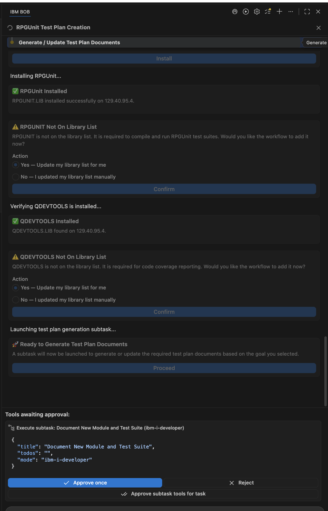

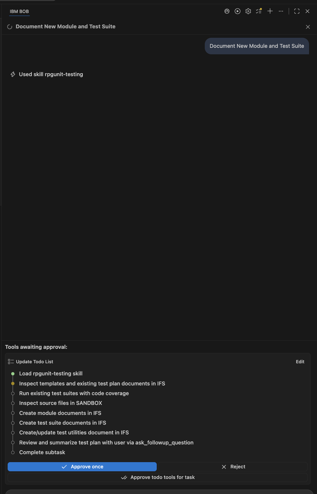

> If Bob warns that searching the many **system libraries** (QSYS, QGPL, and so on) is slow, choose
> **"Yes, continue"** - it is just being cautious.

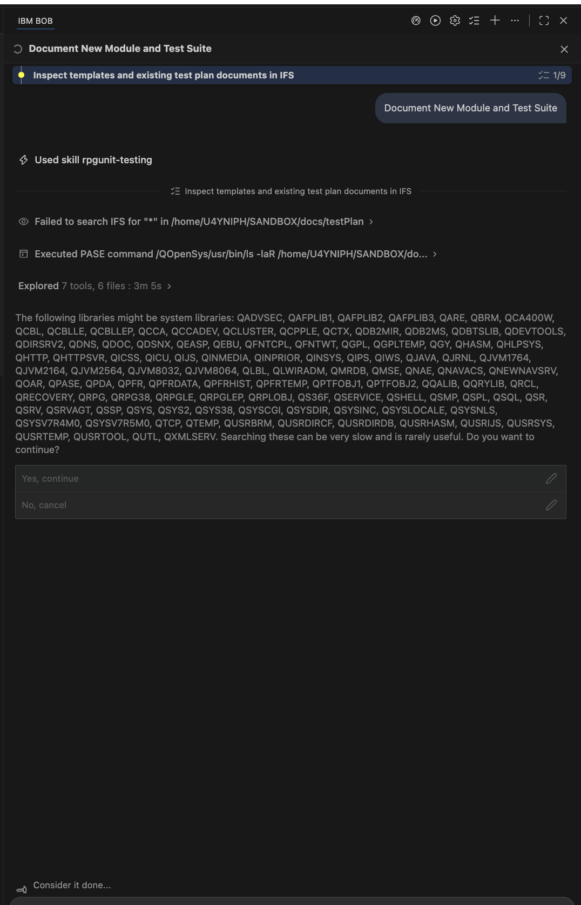

Before it finishes, the subtask shows you a **summary and asks you to confirm** the planned tests -
the human-in-the-loop gate again. Choose **"Yes, the test plan is complete and accurate."**

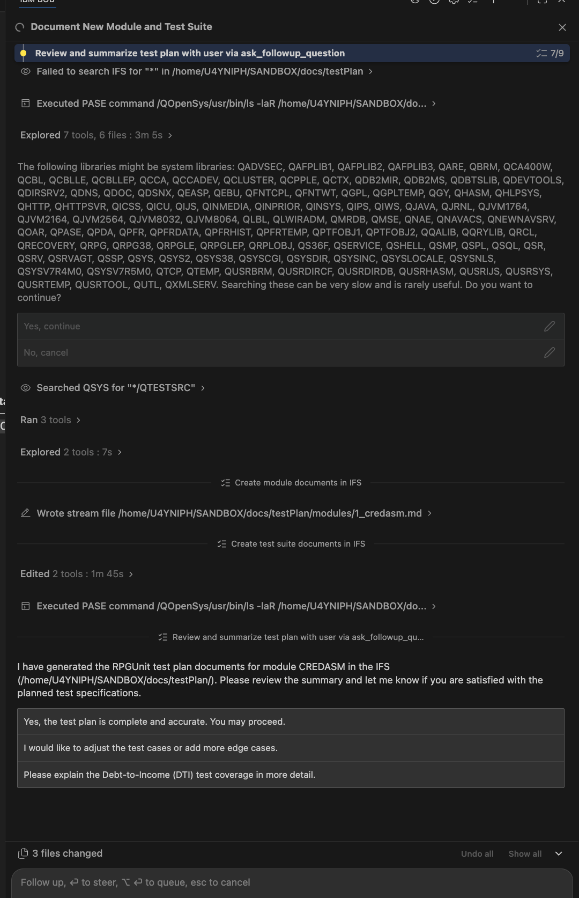

When it is done, the workflow reports **Complete** and tells you what it created in the IFS:

- a **module spec** documenting all 6 of CREDASM's APIs (with Mermaid flowcharts),
- a **test suite spec** with **30 test cases** (boundary conditions, edge cases, error branches, SQL
  database mocking, composite decision logic), and
- a **test utilities** doc (shared mock-table setup/teardown for database isolation in QTEMP).

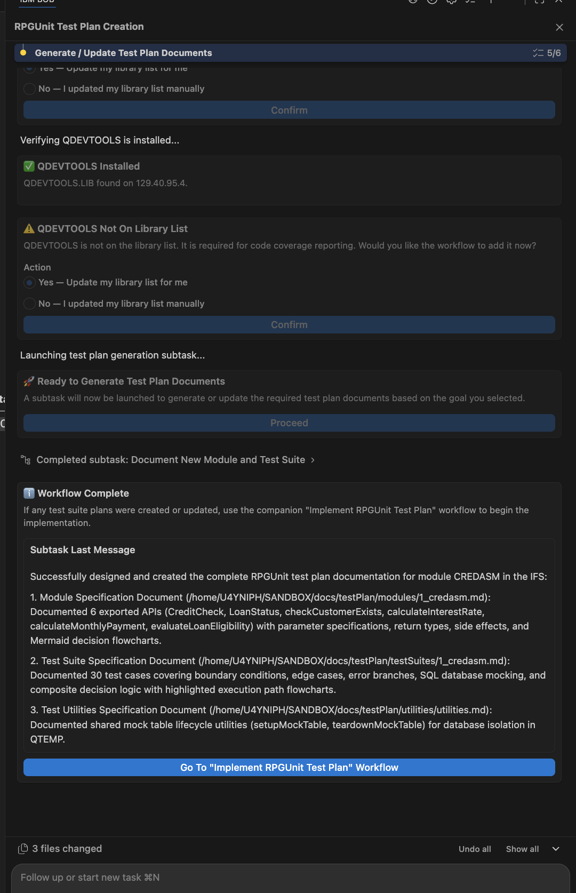

## Part 4b - Implement and run the tests

Click **"Go To Implement RPGUnit Test Plan Workflow"** - it hands off directly. This workflow reads
the test plan, writes the actual RPGUnit test code, compiles it, and runs it.

Pick the **Working Library** (**SANDBOX**) and confirm the **IFS Project Directory** and the test-plan
paths (it confirms it found your `testSuites` directory), then select the test suite to implement.

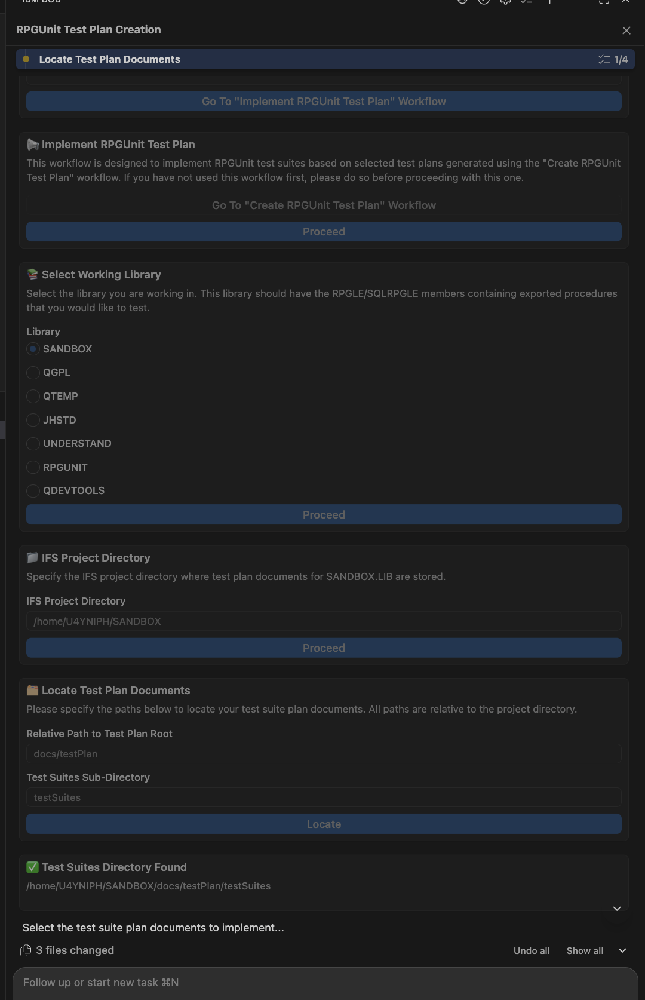

_(Part 4b continues - Bob writes the test code, compiles, and runs the suite for a pass result and a
coverage percentage. Screenshots to follow.)_

---

**You will have learned the full IBM i flow:** understand an app, document its rules, see a change's
blast radius, and build real tests - all with the same Bob, pointed at your box.
