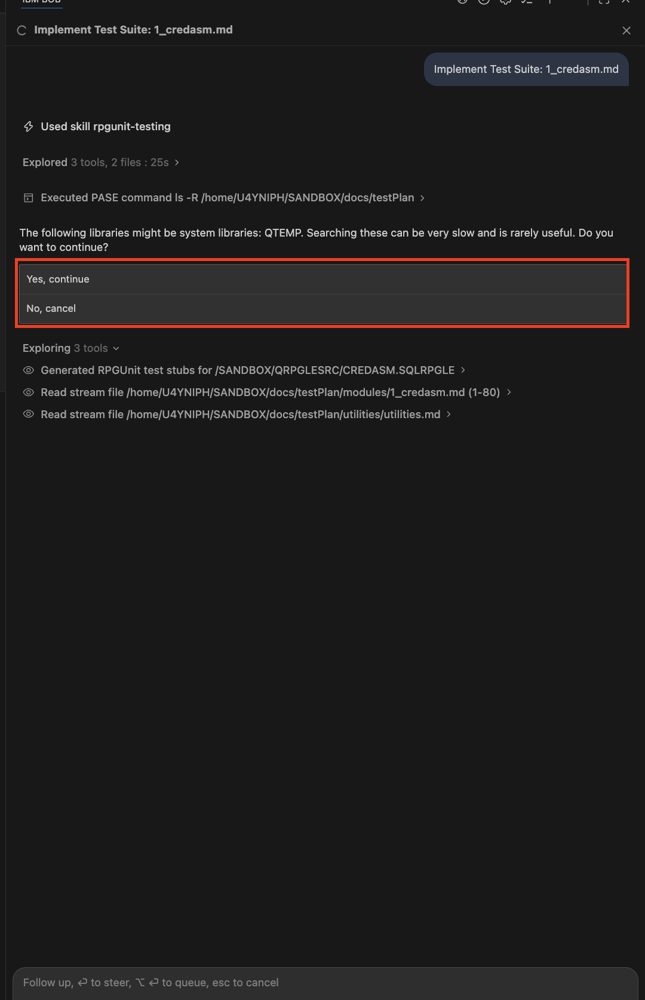
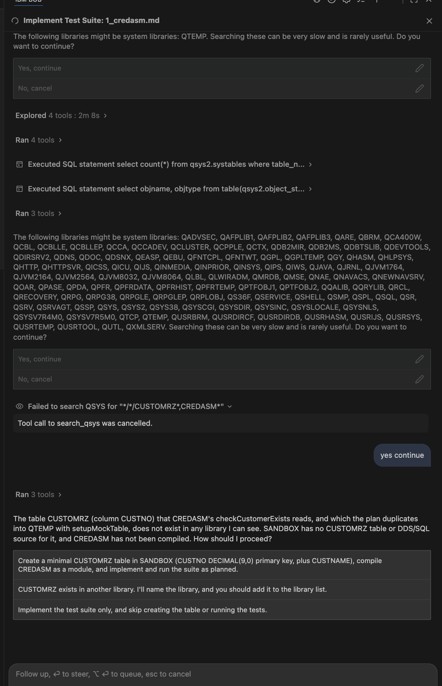
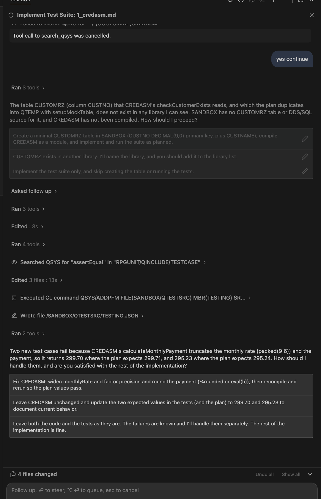
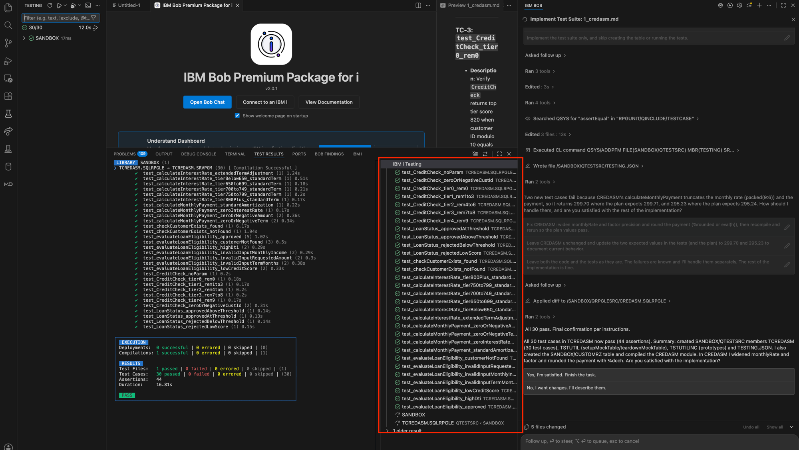

# Bob on IBM i - Premium Package for i Lab

Already comfortable with base Bob from the first lab? Good - this is the **same Bob**, now pointed at
your **IBM i**. Same modes, same approvals, you stay in control the whole time. The Premium Package
for i just adds skills and workflows built for RPG and Db2 for i.

In this lab you will use Bob on a small banking application to do four things a real IBM i developer
does every week: understand a program, document its business rules, see what a change would touch,
and build tests for it.

~60-90 minutes, on a live IBM i connection.

---

## Before you start

This lab assumes you have done the first Bob lab, so you already know **modes** (Ask, Plan, Agent),
how to **approve** changes, and how to switch things in **Settings**. We will not re-teach those here.

You also need:

- **Bob with the Premium Package for i** installed (we verify this in Setup).
- **A connection to an IBM i** - your own, or one your team provides. Connection details (host, user,
  password) come from your organization.

The sample application is **SANDBOX**, a small banking app with customer files and a credit-assessment
service program called **CREDASM**.

## The four parts (one story)

The lab tells one story end to end: **understand -> document -> impact -> test.**

| Part | What you do | The scenario |
|------|-------------|--------------|
| Setup | Connect Bob to your IBM i and install the Understand component | Get Bob onto your box |
| 1. Explain the app | Have Bob read SANDBOX and explain it | The new teammate who reads your codebase over lunch |
| 2. Business Rules | Extract CREDASM's business rules into a plain-English report | The program nobody fully remembers anymore |
| 3. Impact Analysis | Use the Understand scan for a fast blast radius | Before a risky change, what breaks? |
| 4. RPGUnit Testing | Build and run a test suite | The untested monolith, now with a safety net |

---
---

# Setup - get Bob onto your IBM i

Before the fun part, we connect Bob to your IBM i and turn on the **Understand** component, which
builds a map of your application that later parts use.

## Step 1 - Verify you have the Premium Package for i

Open **Bob Settings** (the gear icon at the top-right of the Bob panel), go to **General**, and look
under **Add-ons**. You should see **IBM Bob Premium Package for i** listed as installed.


If it is not there, request access from your team before continuing.

## Step 2 - Connect to your IBM i

On the **Premium Package for i** welcome page, click **Connect to an IBM i**.


Fill in the **IBM i Login** form: a connection name, the host or IP, the port (usually 22), your
username, and one authentication method (password, private key, or SSH agent). Your organization
provides these details.


Once connected, the **IBM i panel** on the left fills in. Two parts matter: the **User Library List**
(your QSYS libraries - SANDBOX should be here) and the **IFS Browser** (folders and files on the IBM i).


> **An IBM i has two file worlds - know both.**
> - **QSYS** is the traditional one: libraries, objects, and source members. Your RPG lives here
>   (for example `SANDBOX/QRPGLESRC/CREDASM`). Think of it as a classic filing cabinet.
> - The **IFS** (Integrated File System) is just regular folders and files, like the file explorer on
>   your laptop (for example `/home/YOURUSER/...`). The **IFS Browser** panel lets you browse it.
>
> Why this matters: later, Bob saves reports as Markdown (`.md`) files. Markdown, PDFs, and logs are
> stream files, and stream files live in the **IFS**. So you will open those reports from the IFS
> Browser, not from a QSYS library.

## Step 3 - Open the Understand Dashboard

Back on the welcome page, find the **Understand Dashboard** card and click **Open Dashboard**.


> **What is Understand? (plain English)** Understand scans your application once and builds a map of
> it - every program and file, and who references who. Think of it as an index for your codebase.
> Later, when you ask "what does changing this file touch?", Bob reads this map and answers in seconds
> instead of searching all your source.

## Step 4 - Point Understand at a library and install it

Understand stores its map in its own IBM i library. Open **Settings**, search for the
`understand.installLibrary` setting, and set the library name (we used **UNDERSTAND**) in both the
**User** and **Workspace** tabs.


> **User vs Workspace (what those tabs mean):** every Bob setting can be saved in two places.
> - **User** - applies to *you*, in every project you open. Your personal default.
> - **Workspace** - applies only to *this* project/workspace, and overrides your user setting when you
>   are in it.
>
> We set it in **both** so the Understand library is found no matter how you open the project. **For
> this lab: type `UNDERSTAND` in the User tab, then switch to the Workspace tab and type it there too.**

Then on the dashboard's **Getting started** list, click **Install Understand**. This creates the
Understand tables and SQL procedures in that library.


Wait for the component to show a green **Installed**.


## Step 5 - Add your application and scan it

On the dashboard, click **+ Add application**.


Fill in the form, then click **Add application**:

- **Display name** - any friendly name for your app. **For this lab, call it `Sandbox App`.**
- **Libraries** - tick the library (or libraries) your application's objects live in. This is what
  Understand will scan. **For this lab, tick `SANDBOX`.**


> If a real application spanned several libraries, you would add each one here. Our sample app lives in
> a single library, so we add just **SANDBOX**.

In **Configured applications**, click the **Scan** (play) button next to Sandbox App.


> **What the scan looks at:** Understand scans your **compiled objects** - the programs, service
> programs, and files that have actually been built on the IBM i (the `*PGM`, `*SRVPGM`, `*FILE`
> objects). It does *not* read raw source members. (On IBM i, you write source and then **compile** it
> into a runnable object; the scan maps the objects and how they call each other.)
>
> One thing this means for our lab: **CREDASM will not appear in this scan yet**, because we have only
> copied its *source* into SANDBOX - it has not been compiled into an object. That is fine; Part 2
> (Business Rules) reads source directly, and Part 4 compiles CREDASM when it needs to run the tests.

When it finishes, the status turns to **Scanned**, and the **Last scanned** column shows **"Just now."**


> **"Last scanned" matters.** The scan is a snapshot in time, not live. "Just now" means the map is
> fresh. If you later add or change objects, this field tells you how stale the map is - and you would
> click **Scan** again to refresh it. (Bob even reminds you of the scan age when it uses the map later.)

Open the **Objects** tab to see what the scan found - here, 9 objects: the customer master file
`CUSTMAST` and the customer programs. Select any object to inspect its dependencies.


> **Reading this table - the key columns:**
> - **Type / Attribute** - what the object is: `FILE / PF` is a physical file (a data table), `PGM /
>   RPGLE` is an RPG program.
> - **Inbound** - how many other objects **depend on this one** (who uses it). This is the important
>   one for impact: `CUSTMAST` has **6 inbound**, meaning 6 programs open it. High inbound = changing
>   it affects a lot of things.
> - **Outbound** - how many objects **this one depends on** (what it uses). A program that opens one
>   file has 1 outbound.
>
> So at a glance: `CUSTMAST` (Inbound 6) is the most-depended-on object here - the risky thing to
> change - while the programs each have low outbound counts. This is exactly the dependency picture we
> dig into in Part 3.

> **One honest limit:** this is an **object-level** scan (programs, files, who-calls-who). It is not
> field-level by itself. We get field-level detail in Part 3 with a quick, scoped source read.

## Step 6 - Browse the Understand library (optional, but it teaches a key idea)

The library you created (UNDERSTAND) holds the scan's data, but it will not appear in the Object
Browser until you add a **filter** for it. First, if UNDERSTAND is not in your **User Library List**,
add it: click the **+** on the User Library List and type **UNDERSTAND**.


Then, in the **Object Browser**, click the **filter** (funnel) icon.


Fill in the filter and save it - **Libraries:** `UNDERSTAND`, **Objects:** `*`, **Object types:** `*ALL`.


> **The filter fields (quick reference):**
> - **Libraries** - which library to browse.
> - **Objects** - object-name pattern (`*` = all).
> - **Object types** - `*ALL`, `*PGM`, `*SRVPGM`, `*FILE`... and `*SRCPF` which means **source files only**.
> - **Members / Member type / Member text** - filter source members.
>
> **Watch the Object types field.** If you leave it on `*SRCPF`, you will see nothing in UNDERSTAND,
> because that library holds **data objects, not source files**. Use `*ALL`. The lesson: a library
> will not show its contents until you add a filter, and the filter must match what is actually in there.

Now the UNDERSTAND library shows its content - the scan's metadata tables (`obj_dep` = dependency
edges, `obj_obj` = all scanned objects, `obj_expsym` = exported procedures) and SQL procedures.


Bob is on your IBM i, the scan is done, and you know the QSYS-versus-IFS difference. Now let's put it
to work.

---
---

# Part 1 - Explain the app

> **The scenario:** you have just been handed a program nobody on your team wrote recently. Before you
> touch anything, you want the tour. This is the teammate who read your whole codebase over lunch.

## Step 1 - Start a task on the IBM i

Click the **+** (new task) in the Bob chat. Bob asks **where** you want to work.


> **The three choices (plain English):**
> - **New task in a local folder** - source on your PC.
> - **New task in Library List** - the IBM i **QSYS** library list (SANDBOX, QGPL, and so on).
> - **New task in IFS Working Directory** - the IBM i IFS (regular folders).
>
> Our RPG lives in QSYS source files inside **SANDBOX**, so pick **Library List**.

Pick **New task in Library List**, and set the mode to **IBM i Developer**.

> **Why IBM i Developer mode?** It is Bob already fluent in RPG, SQLRPGLE, and IBM i - so it
> understands your code instead of guessing. For anything on the IBM i, this is the mode you want.
> (Asking it to explain is still safe - it only reads.)

## Step 2 - Ask it to explain, using the scan

Paste this prompt. Notice it tells Bob to use the **Understand scan** for the structure first, then
read source for the detail:

```
Explain the SANDBOX banking application. First use the Understand scan for the Sandbox App to map out
the structure - the programs and files it contains and how they reference each other (which objects
are most-referenced, who calls what). Then read the relevant source to walk me through exactly what
happens when a customer's balance is updated.
```

> **Why point it at the scan?** You already ran the Understand scan in Setup - it figured out the
> app's structure. Instead of making Bob rediscover everything, you tell it to use the scan for the
> big-picture map and only read source for the detail you care about. Faster, and the scan pulls its
> weight right away.

## Step 3 - Read what it gives you

Bob returns a structured explanation. Section 1 comes **from the Understand scan** - the object map,
the most-referenced object (`CUSTMAST`, with 6 inbound references), a dependency diagram, and the
data model (`CUSTREC` keyed on `CUSTID`; fields `CUSTID`, `CUSTNAME`, `BALANCE`).


Then it reads source for the balance-update flow and - this is the good part - flags the **risks** it
found: no audit trail, silent failure on a missing customer, no I/O error handling, and places the
code does not match the project's standards.


**You just learned:** Bob can read an IBM i application it has never seen, use the scan for structure,
read source for detail, and give you an honest tour - risks included.

---
---

# Part 2 - Business Rules Extraction

> **The scenario:** every shop has that one program that encodes years of business decisions, and the
> people who wrote it have moved on. You point Bob at it and get those rules back in plain English -
> straight from the code - so an analyst can read them, not just a developer.

We run this on **CREDASM**, the credit-assessment service program (it decides whether a customer
qualifies for a loan, sets the interest rate, and calculates the monthly payment).

## Step 1 - Start the Business Rules Extraction workflow

In the Bob chat, click the **Start Workflow** (play) icon at the top.

> **What is a workflow? (plain English)** In base Bob you drove step by step. A workflow is a guided,
> multi-step process for a common IBM i job - it walks you through it and does the heavy lifting.

The **Bob workflows** panel lists five. Click **Start** on **Business Rules Extraction**.


Read the **Welcome** screen, then click **Get Started**.


## Step 2 - Point it at CREDASM

The workflow detects your QSYS workspace and walks you through three picks. Each one narrows down to
the exact program you want to analyze: first the **library**, then the **source file** inside it, then
the **member** (the actual program).

**Library** - choose the library your program lives in. **For this lab that is SANDBOX.**


**Source file** - choose the source physical file that holds your RPG members. RPG usually lives in
**QRPGLESRC**, so **for this lab pick QRPGLESRC.**


**Member** - choose the specific program you want the rules for, then click **Analyze Member**. **For
this lab pick CREDASM.SQLRPGLE** (the credit-assessment program).


## Step 3 - Watch it work (what is actually happening)

Bob now works through the program. The screen narrates each step, so you can see what it is doing
rather than just waiting.


Here is what each line means, in order:

- **"269-line RPGLE, FREE, SQL program is being parsed for external dependencies."** First Bob reads
  the whole program and checks whether it relies on *other* objects (files, copybooks, other programs)
  it would also need to understand.
- **"No external dependencies detected."** CREDASM is self-contained - it does not pull in other
  objects - so the workflow can proceed cleanly.
  > If a program *does* reference something Bob cannot find, it will **stop and ask you for the path**
  > instead of guessing. That is normal and correct - just point it at the file. (We see exactly this
  > honest behaviour later, in Part 4.)
- **"Extracting Business Rules - 13 bundles, 2 extraction tasks in parallel."** Bob splits the program
  into logical chunks (by procedure and section) and analyzes several at once to go faster. Each chunk
  is read for its rules, validations, calculations, and decision logic.
- **"Extraction complete - 10 rules."** It found 10 distinct business rules across the program's
  procedures (credit check, loan status, interest rate, monthly payment, loan eligibility).
- **"Synthesis Report - generating..."** Bob takes those raw findings and writes them up into the
  eight-section, business-friendly document (the one we read in the next step).
- **"Mermaid Generation - 2 diagrams generated."** It also draws the logic as diagrams.

Notice the small number next to each step (for example `0.118`) - that is the **coin cost** of that
step. The entire extraction here came to roughly a quarter of a coin. Reading a 269-line program and
producing a full rules document for pennies is the point.

When it is done, it offers a **save location** - an IFS path for the Markdown report.


> **Your choice here:** you can **accept the suggested IFS path** (Bob picks a sensible folder under
> your home directory) or **edit the filename/path** to match where your team keeps docs. **For this
> lab: accept the suggested path** and click **Continue**. Remember it is saving to the **IFS** (the
> folders world), because a Markdown report is a stream file.

## Step 4 - Read the report (and understand what is in it)

Open the saved file from the **IFS Browser** (remember: Markdown reports live in the IFS, not in a
QSYS library). Turn on **Preview** to read it as a formatted document instead of raw text.


This is not a code dump - it is a **business-friendly document** an analyst could read. Let's walk
through what each part actually contains, so nothing is a mystery. The report has **eight sections**;
here is what they mean:

**1. Executive Summary** - the plain-English "what is this program" overview. For CREDASM it states:
- **Business Purpose:** CREDASM decides whether a customer qualifies for a loan, and if approved, sets
  the interest rate and the estimated monthly payment.
- **Key Business Functions:** assign a credit score, check it against a minimum, confirm the customer
  exists, price the loan (interest rate), and calculate the monthly payment.
- **Business Context:** the program is a decision engine that runs a fixed sequence of **gates** - does
  the customer exist, is the request data complete, is the credit score high enough, and is the loan
  affordable (a **debt-to-income limit of 43%**). A request is approved only if it passes every gate.
- **Reason codes:** each refusal carries a code so the outcome can be explained - `NO_CUST` (no
  customer), `INV_INPUT` (bad input), `LOW_SCORE` (credit score too low), `HIGH_DTI` (debt-to-income
  too high).

> **An honest note Bob included, not an assumption:** the report flags that the credit score here is
> **not** based on real credit history - it is derived from the last digit of the customer ID, so it is
> a simulated/sample scoring rule. That is Bob telling you what the code *actually* does, rather than
> what you might assume a "credit score" means. This is why extraction beats guessing.

**2. Detailed Business Rules** - the individual rules, grouped by area, each with its logic spelled
out. For example, the **Credit Score Assignment** rule: if no customer ID is supplied the score
defaults to 750; if the ID is zero or negative the lowest score (300) applies; otherwise the last
digit of the customer ID selects the score (shown as a lookup table).

**The remaining sections** cover the other kinds of logic Bob found in the code:

- **Validations** - the input checks the program enforces (which fields must be present, valid ranges).
- **Calculations** - the formulas, such as how the interest rate and the monthly payment are computed.
- **Decision logic** - the branching that produces approve/refuse and each reason code.
- **Data integrity** - what the program assumes about its data and files.
- **Process flow** - the end-to-end order the gates run in.
- **Assumptions / coverage notes** - where Bob was uncertain or where the sample app simplifies real
  behaviour, called out explicitly instead of hidden.

**Mermaid diagrams.** The report also embeds up to three diagrams. Open the decision-tree one to see
the whole flow drawn out - loan request, each gate in order, every refusal code, and final approval.


> **How to read the diagram:** each **diamond** is a decision gate ("Customer exists?", "Score at least
> 700?", "Debt-to-income at or below 43%?"), each **Yes** path moves forward to the next gate, and each
> **No** path ends in a refusal with its reason code. The only way to the "Approve" box at the bottom
> is to pass every gate. A business analyst can read the program's entire logic from this one picture.

**You just learned:** Bob read a 269-line RPG program and turned it into an eight-section, readable
rules document plus a decision diagram - the purpose, the gates, the reason codes, the formulas, and
an honest note that the score is simulated - for a fraction of a coin. No one had to read the RPG to
understand what the program does.

---
---

# Part 3 - Impact Analysis

> **The scenario:** you are about to change a field on a heavily-used file. Before you do, you need the
> blast radius - every program and object that would be affected. On IBM i these dependencies are easy
> to miss with a manual search. The Understand scan already mapped them, so this comes back fast.

## Step 1 - Ask for the blast radius, from the scan

New task, **Library List** workspace, **IBM i Developer** mode. Paste:

```
Using the Sandbox App Understand scan metadata only - don't read the source. What is the full blast
radius if I change CUSTMAST? List every program that reads or writes it, rank them by impact, and show
the dependency as a diagram.
```

> **This is the whole point of this part.** The key phrase is "scan metadata only - don't read the
> source". Because the scan already mapped everything, Bob answers in **seconds** instead of grepping
> your whole library (which is slow and easy to get stuck in).

## Step 2 - Read the blast radius

Right at the top, Bob says **"I used scan metadata only and read no source."** It returns a ranked
list of the programs that touch CUSTMAST, a risk rating, and a colour-coded dependency diagram.


> **How to read this response:**
> - **The ranked table** lists every program that uses CUSTMAST, ordered by impact. The **Access**
>   column says whether each one **reads** or **writes** the file - `CUSTUPD` is the only **writer**, so
>   it is ranked #1 (the riskiest, because it changes data). The rest only read.
> - **Risk: Medium to High** - Bob's judgement that a record-format change here would force every one
>   of those programs to be recompiled.
> - **The diagram** draws the same thing: all the programs pointing at `CUSTMAST`, colour-coded, with
>   the writer highlighted.
>
> Notice how fast this came back - it read the scan, not your source. That is the whole point.

## Step 3 (optional) - Go to field level

The blast radius above is **object-level** and instant. For field-level detail, follow up - this one
reads source, but only the few programs involved, so it is still fast:

```
Now read only those programs' source and tell me which ones specifically use the BALANCE field, with
member:line citations.
```

Bob reads just those programs (here, 6 files in about 7 seconds) and gives exact `member:line`
citations - CUSTUPD writes BALANCE at line 15, CUSTINQ returns it at 39, CUSTBAL flags it negative at
31 - plus which change types force a recompile, and a sharp hazard (resizing BALANCE means changing
three hard-coded `packed(11:2)` declarations together, or you get wrong data at runtime).


**You just learned:** two levels of impact - an **object-level blast radius that is instant from the
scan**, and **field-level detail from a quick, scoped source read**. No slow grep of the whole library.

---
---

# Part 4 - RPGUnit Testing

> **The scenario:** the program you are afraid to change. Tests are the safety net that lets you change
> it with confidence. Bob reads the code, plans the tests, writes them, and runs them.

> **Why CREDASM?** RPGUnit tests **exported procedures**. CREDASM is a service program built from
> procedures (checkCustomerExists, calculateInterestRate, evaluateLoanEligibility, and so on), so each
> one is directly testable. Programs that keep their logic in the mainline (like CUSTUPD) are not
> directly unit-testable - that is the "monolith" problem, and the first step for those is to extract
> their logic into procedures. CREDASM already is, which is why it is the one we test.

## Part 4a - Create the test plan

Click **Start Workflow** and choose **RPGUnit Test Plan Creation**. The Overview explains it produces
four kinds of Markdown docs (templates, module docs, test suite docs, and a utilities doc). Click
**Get Started**.


Pick your **Working Library** - the library that holds the program you want to test. **For this lab
that is SANDBOX.** Then accept the **IFS Project Directory** (where the test-plan docs will be saved)
and click **Proceed**.


Then Bob asks whether you already have a test plan.


> **Your choices here:**
> - **Yes - I have an existing test plan** - pick this if you have run this workflow before and just
>   want to add to or extend the docs you already created.
> - **No - Create one for me** - pick this to start a brand-new test plan from scratch.
>
> **For this lab: pick "No - Create one for me."** We are starting fresh.

Next it shows the **directory structure** for the test-plan docs.


> **About these fields:** they are just the folder names Bob will use to organize the test-plan docs in
> the IFS (a root folder plus sub-folders for templates, modules, test suites, and utilities). You can
> rename them to match your team's layout. **For this lab: accept the defaults** and click
> **Create Test Plan**.

Now Bob asks what you want to accomplish - the **goal**.


> **Your choices here:**
> - **Document New Module and Test Suite** - does both jobs at once: documents the program's procedures
>   *and* plans the test cases. Best when you are starting fresh.
> - **Document New Module** - only documents the procedures (the "what does this API do" doc), no tests
>   planned yet. Pick this if you just want the API documented.
> - **Document New Test Suite** - adds a test-suite doc to a module you have *already* documented.
> - **Update Existing Module Document** - refresh a module doc after the code changed (maintenance).
> - **Update Existing Test Suite Document** - refresh a test-suite doc after your tests changed.
>
> **For this lab: pick "Document New Module and Test Suite (Recommended)."** First time through, it
> does the whole job in one go.

Now Bob asks how to find the testable files - the **Location Strategy**.


> **Your choices here:**
> - **Locate (Recommended)** - Bob automatically searches your library and finds the files that have
>   exported procedures (the testable ones).
> - **Manual** - you pick the files yourself.
>
> **For this lab: pick "Locate (Recommended)."** Let Bob find them.

Bob searches the 9 members and finds **one testable file - CREDASM, with 6 procedures.** Keep it
checked and **Proceed.**

> **This is the monolith lesson, live.** Bob checked all 9 members and only CREDASM came back as
> testable - because it is the only one whose logic lives in exported procedures. The others keep their
> logic in the mainline, so RPGUnit cannot test them directly. That is the real-world "monolith"
> problem: to test those, you would first extract their logic into procedures.

Keep all 6 procedures checked. The workflow then **validates the environment** - it needs **RPGUNIT**
(to compile and run tests) and **QDEVTOOLS** (for coverage). If RPGUnit is not installed, it offers to
install it for you - click **Install**.


> **Good news for setup:** the workflow installs RPGUnit itself and adds it to your library list - so
> there is no separate extension setup to do by hand.

It asks which **version** of RPGUnit to install.


> **Your choices here:** the list shows the **Recommended** bundled version at the top and a history of
> released versions below it. **For this lab: pick the Recommended version (v6.0.0)** - it is the safe,
> known-good one. (Only pick a specific newer version if your team requires it.)

RPGUnit installs successfully. Then Bob notes that RPGUNIT is not yet on your library list and asks to
add it.


> **Your choices here:**
> - **Yes - Update my library list for me** - Bob adds RPGUNIT (and QDEVTOOLS) to your library list so
>   the tests can compile and run.
> - **No - I updated my library list manually** - pick this only if you already added them yourself.
>
> **For this lab: pick "Yes - Update my library list for me."** Let Bob handle it. You will answer the
> same way for QDEVTOOLS (used for code coverage).

With the environment ready, the workflow launches a subtask to generate the docs. **Approve** the
subtask, and **approve** its todo list (load the rpgunit-testing skill, inspect templates, inspect
source, create the module/test-suite/utilities docs).


> If Bob warns that searching the many **system libraries** (QSYS, QGPL, and so on) is slow, choose
> **"Yes, continue"** - it is just being cautious.


Before it finishes, the subtask shows you a **summary and asks you to confirm** the planned tests -
the human-in-the-loop gate again.


> **Your choices here:**
> - **Yes, the test plan is complete and accurate** - you are happy with the planned tests; Bob
>   finishes and saves them.
> - **I would like to adjust the test cases or add more edge cases** - pick this to send it back for
>   changes.
> - **Please explain the coverage in more detail** - pick this to have Bob walk you through what it
>   planned before you decide.
>
> **For this lab: pick "Yes, the test plan is complete and accurate."**

When it is done, the workflow reports **Complete** and tells you what it created in the IFS:

- a **module spec** documenting all 6 of CREDASM's APIs (with Mermaid flowcharts),
- a **test suite spec** with **30 test cases** (boundary conditions, edge cases, error branches, SQL
  database mocking, composite decision logic), and
- a **test utilities** doc (shared mock-table setup/teardown for database isolation in QTEMP).


## Part 4b - Implement and run the tests

Click **"Go To Implement RPGUnit Test Plan Workflow"** - it hands off directly. This workflow reads
the test plan, writes the actual RPGUnit test code, compiles it, and runs it.

Pick the **Working Library** - the same one your program and test plan are in. **For this lab that is
SANDBOX.** Confirm the **IFS Project Directory** and the test-plan paths (it confirms it found your
`testSuites` directory), then select the test suite to implement.


Bob reads the test plan and **generates the RPGUnit test stubs** for CREDASM. (If it warns that
searching system libraries like QTEMP is slow, choose **"Yes, continue"**.)



## Step 4b.2 - Bob diagnoses a missing dependency (and asks you)

Here is a moment worth slowing down on. Bob discovers that CREDASM's `checkCustomerExists` reads a
table called **CUSTOMRZ** that does not exist in SANDBOX, and that **CREDASM has not been compiled**.
Instead of failing, it **tells you exactly what is missing and asks how to proceed.**



> **This is the honest, human-in-the-loop behaviour in action.** Bob does not blindly fail or invent
> data - it explains the gap and gives you options.
>
> **Your choices here:**
> - **Create a minimal CUSTOMRZ table in SANDBOX, compile CREDASM, and run the suite** - Bob sets up the
>   missing test data itself and runs the tests. Pick this when the table is genuinely missing (our case).
> - **CUSTOMRZ exists in another library** - pick this if the table lives somewhere else; you name the
>   library and add it to your list.
> - **Implement the test suite only, skip creating the table or running the tests** - pick this to just
>   write the tests and deal with the environment later.
>
> **For this lab: pick the first option** (create the table, compile CREDASM, run the suite). Now Bob
> can set up the test environment and actually run the tests.

## Step 4b.3 - The tests catch a real bug

Bob creates the table, compiles CREDASM, writes the test code and configuration, and runs the suite.
Two tests **fail** - and this is the best thing that can happen. They caught a **real bug**:
`calculateMonthlyPayment` truncates the monthly rate, so it returns `299.70` where it should be
`299.71`. A genuine rounding defect in the business logic, found by the tests.



Bob asks how to handle it.

> **Your choices here:**
> - **Fix CREDASM** - widen the precision, round the payment, recompile, and rerun so the tests pass.
>   Pick this when the *code* is wrong and you want it fixed (our case - it is a real bug).
> - **Leave CREDASM unchanged and update the expected values in the tests** - pick this if the current
>   behaviour is actually correct and the *test* expectation was wrong; it documents what the code does.
> - **Leave both as they are** - pick this to note the failures as known and handle them separately.
>
> **For this lab: pick "Fix CREDASM."** This is the whole point of testing, in one screen - the suite
> did not just pass for show, it found a penny-off rounding bug in a payment calculation, flagged it,
> and asked you what to do. Fixing it completes the loop: write tests, catch a bug, fix the code, rerun.

## Step 4b.4 - Green

Bob fixes CREDASM (widens the precision, rounds with `%dech`), recompiles, and reruns. **All 30 tests
pass - 44 assertions, 0 failed, 0 errored.** The IBM i Testing panel shows the full green run.



> **How to read the test-results panel:**
> - **30/30** at the top and the green checks - every test case passed.
> - **Test Cases: 30 passed | 0 failed | 0 errored** - no failures (a *failure* is a wrong answer; an
>   *error* is the test itself blowing up). All clean.
> - **Assertions: 44** - the individual checks inside those tests (one test can check several things).
> - **Compilations: 1 successful** - CREDASM (with the fix) compiled cleanly.
> - **PASS** - the whole suite is green.
>
> (The "109 problems" at the bottom of the editor is just normal lint/warning noise in the editor, not
> test failures - ignore it.)

Along the way Bob created the test members (`TCREDASM` with 30 cases, `TSTUTIL` with the mock-table
helpers), the `TESTING.JSON` config, the `CUSTOMRZ` table, compiled CREDASM, and applied the fix - all
with your approval at each step.

**You just learned:** Bob can take an untested program, plan tests for it, build and run them, diagnose
a missing dependency honestly, catch a real bug, fix it, and get to a green suite - your safety net is
now live.

---

## You did it - the full IBM i flow

With the same Bob you learned in the first lab, now on a real IBM i, you:

- **Understood** an application you had never seen, using the Understand scan for structure.
- **Documented** a legacy program's business rules in plain English, with diagrams.
- **Analysed the impact** of a change - instant blast radius from the scan, plus field-level detail.
- **Tested** a program end to end - and the tests caught and fixed a real bug.

That is understand, document, impact, test - the everyday work of IBM i development, accelerated, with
you in control the whole way.

---

**You will have learned the full IBM i flow:** understand an app, document its rules, see a change's
blast radius, and build real tests - all with the same Bob, pointed at your box.
